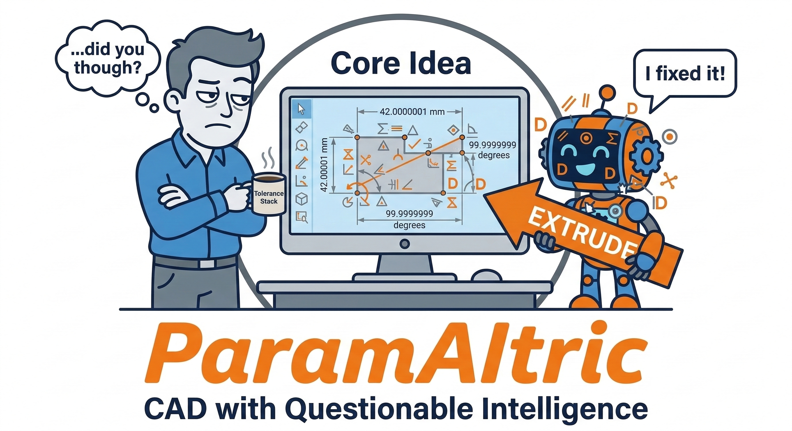
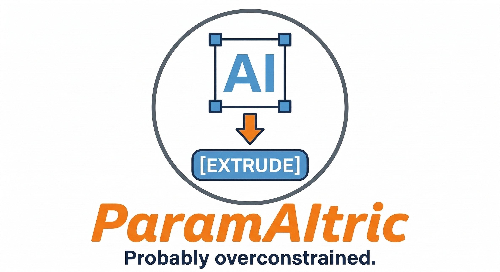

  

  <a href="https://youtu.be/DqIeypqgORg"><b>▶ Watch the demo</b></a>

# ParamAItric

AI-assisted CAD for functional parametric designs.

ParamAItric is a CAD tool for creating functional parts from structured dimensions and requirements.

It uses constrained MCP tools, staged workflows, and geometry verification. Autodesk Fusion 360 remains the default backend. Explicitly configuring cadgen/build123d enables a narrow guided plate workflow on Linux, including retained parameter edits, STEP/STL and saved-geometry inspection. Target-hardware viewer qualification remains a separate gate.

The goal is not full autonomous CAD. The goal is a reliable path from structured intent to editable Fusion geometry for useful mechanical work — especially utility and maintenance parts: brackets, plates, covers, adapters, handles, and other small replacement parts that are simple to model but expensive or slow to procure.

ParamAItric is intended to help operators, technicians, and hobbyists generate functional replacement parts and brackets, but the current setup is still developer-style. Today it requires a local repo clone, Python environment setup, Fusion add-in installation, and MCP client configuration. **New users should start with the [installation guide](INSTALL.md), which walks through setup and building your first part step by step.**

## What It Includes

- Fusion add-in bridge (loopback HTTP plus Fusion main-thread execution)
- MCP server for input validation, workflow orchestration, and verification
- Read-only inspection tools for body, face, and edge geometry
- Local regression tests and a live smoke runner
- Packaged MCP stdio entrypoint for desktop hosts (Claude Desktop, Cursor, etc.)

## Current Product Shape

Today, ParamAItric is best understood as:

- a local Fusion 360 add-in
- a local MCP server launched from a repo clone
- a validated workflow library for dependable small mechanical parts

That makes the current experience suitable for builders, testers, and early adopters. It is not yet packaged as a one-click consumer install.

## Project Direction

**Consolidate, specialize, validate, simplify.** ParamAItric Utility combines mature
open-source CAD components into a local product for functional maintenance parts.
ParamAItric owns requirements, parameterized intent, workflow sequencing and
verification; replaceable adapters own CAD execution. CPU modeling on AMD/Linux
does not require CUDA or GPU acceleration.

The first open-backend proof is an 80×60×5 mm plate with a centered 10 mm hole,
followed by width regeneration to 100 mm. Real saved STEP/STL geometry and retained
source recipes were tested through an actual MCP stdio client. The existing guided
tools route the configured open backend; default Fusion behavior is preserved.
Revision acceptance is atomic and saved artifacts are checked for modifications
before inspection or replay. The existing viewer was exercised on an AMD desktop;
Strix Halo and fresh live Fusion qualification remain incomplete.
See the [capability matrix](docs/consolidation/capability_matrix.md)
and [integration runbook](docs/consolidation/integration_plan.md). For the current
reboot pause and restart commands, read the [pause handoff](docs/consolidation/pause-2026-10-13.md).

Near-term priorities:

- Qualify a flat L-profile bracket through the existing guided tools, independently of hardware/Fusion availability.
- Qualify the guided plate path and interactive viewer on Strix Halo hardware.
- Capture fresh Fusion saved-geometry parity evidence.
- Preserve Fusion and its regression/safety contracts.
- Expand to spacers, basic brackets, bushings/adapters and clamps one verified family at a time.

FreeCAD native feature-history documents remain a future option. SMLib remains
research. Neither is required for this first slice. Installation simplification
follows a proved product path. Historical Pi/Lemonade/Qwen → Fusion acceptance
remains unproven; deterministic CAD tests do not satisfy it.

## Current Capability (Broad)

Validated workflow families currently cover:

- flat utility parts (spacers, plates, holes, slots, recesses)
- bracket family (plain, mounting-hole, filleted, chamfered)
- enclosure and lid paths (open box, matched lid, shelled enclosure)
- cylindrical and revolve-driven utility parts (solid/hollow cylinders, socketed handle-style parts)

## Operating Model

Each workflow follows the same reliability contract:

1. validate schema before CAD operations
2. execute explicit stages in order
3. verify geometry at milestones
4. stop on failed verification with structured failure context
5. export STL from the validated body

## Operating Modes

### Work Mode

The default. Deterministic part creation where predictability matters more than breadth.

- small tool surface
- strong validation
- explicit stage ordering
- verification checkpoints between milestones
- clear failures with partial progress preserved

### Utility Operations Mode

Automation around an existing design rather than geometry creation. Lower-risk operational style.

- low-risk operations
- clear reporting on what changed
- stronger file and path controls

### Creative Mode

Later-stage exploratory modeling after the reliable core is strong enough. Useful for evaluation and edge testing, but not the primary value proposition.

## Design Philosophy

- staged workflows outperform one-shot requests
- validation before CAD operations matters
- verification after each major step matters
- human correction loops are a normal operating model
- more complex workflows should be built from proven smaller workflow paths
- keep the workflow surface narrow and explicit
- prefer typed operations over broad natural-language commands
- preserve clean partial results when a workflow fails
- expand only after the previous slice is stable
- let real parts drive the next workflow gaps
- keep the user in control of risky or destructive actions

---

## Getting started

ParamAItric currently runs as a local Fusion 360 add-in plus a local MCP server launched from a repo clone. Setup takes about 15 minutes and you only do it once.

**[INSTALL.md](INSTALL.md) is the single setup guide.** It covers prerequisites, the one-command bootstrap (`scripts/setup.ps1` / `scripts/setup.sh`), the manual step-by-step install, connecting your AI client, making your first part in plain language, and printing it.

The flow, in short:

1. Clone the repo and create a Python virtual environment.
2. Install and run the Fusion 360 add-in.
3. Point your MCP client (Claude Desktop, Cursor, etc.) at the local server.
4. Ask for a part in plain language, then review and export it.

See [INSTALL.md](INSTALL.md) for the exact commands.

---

## Canonical docs

- [docs/consolidation/architecture.md](docs/consolidation/architecture.md): product/backend boundaries and verification ownership
- [docs/consolidation/handoff.md](docs/consolidation/handoff.md): changes, actual test results, evidence gaps and next task
- [resources/README.md](resources/README.md): pinned dependency/reference downloads and offline setup
- [docs/README.md](docs/README.md): short guide to current canon versus archived historical docs.
- [INSTALL.md](INSTALL.md): Comprehensive setup guide for all skill levels.
- [ARCHITECTURE.md](ARCHITECTURE.md): system boundaries, execution model, and safety constraints
- [HOST_INTEGRATION.md](HOST_INTEGRATION.md): intended MCP host integration model and transport direction
- [BEST_PRACTICES.md](BEST_PRACTICES.md): living workflow and prompting contract
- [docs/VERIFICATION_POLICY.md](docs/VERIFICATION_POLICY.md): adopted verification trust tiers and runtime-vs-audit policy
- [docs/CSG_CHECKLIST.md](docs/CSG_CHECKLIST.md): short deterministic workflow checklist for planning and review
- [docs/FREEFORM_PLAYBOOK.md](docs/FREEFORM_PLAYBOOK.md): guided freeform operating model, verification rules, and promotion standards
- [docs/FREEFORM_CHECKLIST.md](docs/FREEFORM_CHECKLIST.md): short guided freeform session checklist
- [ROADMAP.md](ROADMAP.md): the single canonical roadmap — iterations, stages, and where old plans went
- [docs/Lemonade Integration Specification.pdf](docs/Lemonade%20Integration%20Specification.pdf): local-LLM (Lemonade + Pi) integration spec driving the current direction
- [docs/setup/](docs/setup/): per-iteration setup guides (claude-fusion today; lemonade-fusion, strix-remote, strix-native planned)
- Superseded planning docs are preserved under [docs/archive/planning/](docs/archive/planning/)
- [docs/dev-log.md](docs/dev-log.md): execution evidence, validation results, and durable rationale changes

Internal working notes:
- [internal/freeform-architecture.md](internal/freeform-architecture.md): freeform session contract and architecture note
- [internal/test-recipes.md](internal/test-recipes.md): temporary structured and freeform recipe corpus used for validation sessions

  

