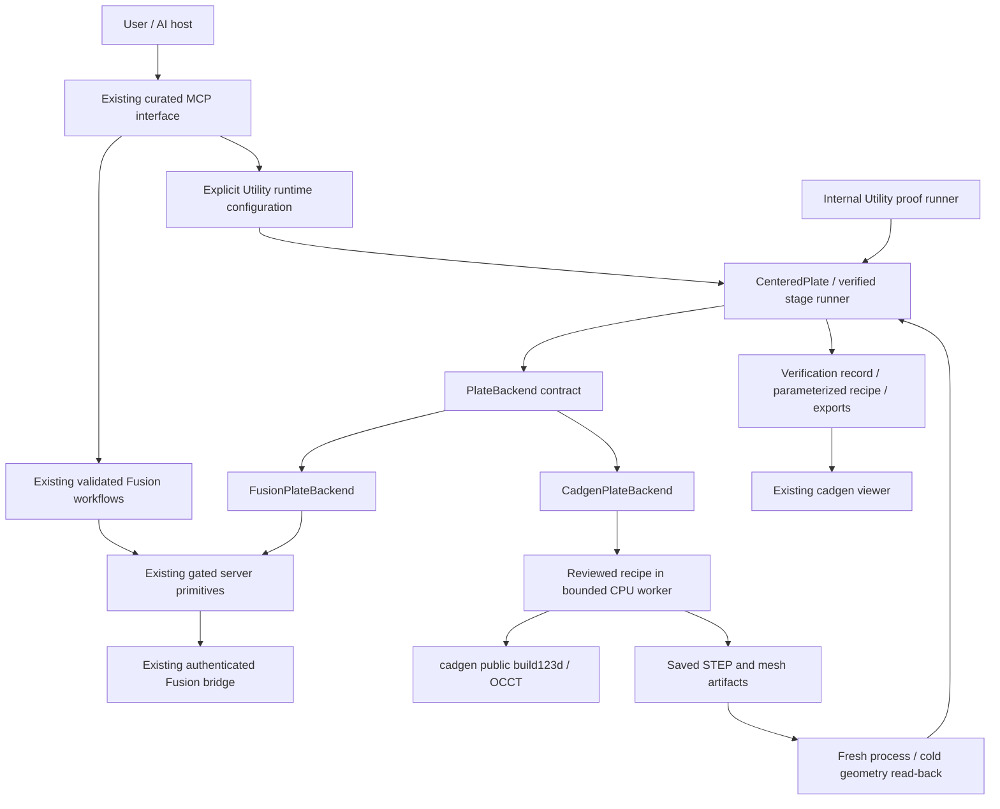

# ParamAItric Utility: product and execution boundaries

Status: implemented narrow plate boundary and configured guided MCP path; default
Fusion route retained. See [baseline](baseline.md), [capabilities](capability_matrix.md)
and [integration steps](integration_plan.md). No automatic backend selection.

Updated direction, 2026-10-14: freeze additional cadgen modeling recipes while
evaluating SolidCraft as the complete modeling/document/UI foundation. The
[bounded evaluation](solidcraft_evaluation.md) demonstrates native plate/L-profile
editing with independent OCCT verification, but identifies cancellation and error
contract gates before production adoption. The diagram below describes the
preserved reference implementation, not a commitment to duplicate SolidCraft.

## Integrated SolidCraft path

Explicit `PARAMAITRIC_CAD_BACKEND=solidcraft` selects the two-family native intent
path through the existing guided tools. `mcp_server/solidcraft_runtime.py` reuses
Utility transaction/cancellation/atomic publication; `cad_backends/solidcraft/`
owns native commands, bounded processes and cold independent OCCT read-back.
The product loads accepted revisions only after fixed artifact hashes match,
including `.solidcraft`. No generic operation vocabulary was added to emulate a
native feature system. [Setup and transaction details](solidcraft_integration.md).

The proposed SolidCraft ownership diagram in [the evaluation](solidcraft_evaluation.md)
now has a working headless execution path; interactive review remains unqualified.
The diagram below continues to document the frozen OCCT reference.

## Native external edits

The same `cad_build` surface now prepares an owned copy and explicitly revalidates
it. `cad_backends/solidcraft/external_edits.py` provides bounded snapshots and strict
comparison of public native JSON against an allowed-change parent regenerated by
SolidCraft. It is not an intermediate modeling representation. The runtime owns
parent/copy provenance, expected dimensions, source drift checks, hashed submitted
bytes and new-revision publication. Existing native editing and independent reader
paths are reused. [Contract](external_edit_revalidation.md).

## Ownership

ParamAItric owns requirements, units, recipes, workflow sequencing, acceptance,
failure/recovery and provenance. External libraries own geometric construction,
interchange and rendering. A successful kernel call is not an acceptance result.

The proof runners are developer harnesses, not second AI-agent surfaces. The
existing `cad_build` plate workflow now routes through an explicitly configured
backend. No external CAD agent gets control of acceptance or routing. Selecting
cadgen exposes only the five existing guided tools and one qualified part family.
Unsupported requests fail before mutation; Fusion remains the default.

## Actual layout and contracts

| Location | Responsibility |
|---|---|
| `mcp_server/utility_plate.py` | Validated centered plate; parameter relationship; operation sequence; mandatory checks; revision replay |
| `mcp_server/utility_runtime.py` | Explicit configuration, scoped requirements/discovery, accepted revision records, guided routing, read-only exported STEP inspection and transaction guard |
| `mcp_server/operations.py` | Existing new_body/cut/add/intersect vocabulary; finite placement coordinates added for the bore |
| `cad_backends/protocol.py` | Small start/apply/inspect/export protocol; capabilities, editability and adapter-private part handle |
| `cad_backends/fusion.py` | Translate two supported operations using existing gated primitives; normalize bridge read-back into mm |
| `cad_backends/cadgen/adapter.py` | Dedicated Python process, fixed recipe, ownership, bounded execution and structured failures |
| `cad_backends/cadgen/recipe.py` | Repository-authored box and cylindrical cut using mature kernel operations; saved STEP reader and STL validation |
| `evaluations/utility_plate.py`, `evaluations/utility_guided.py` | Internal contract proof and actual MCP stdio build/edit/read-back; no language model in the loop |
| `resources/`, `scripts/prepare_cad_resources.py` | Versioned download plan; ignored, checksummed local resource cache |

Only plate XY geometry is translated. There is no new universal operation IR,
backend registry, model router, renderer, kernel, or plugin framework. `add` and
`intersect` remain in the vocabulary; these adapters explicitly do not support them.
Opening arbitrary native documents is not implemented. `start_part` starts a new
part; a stored centered-plate recipe regenerates into a new immutable output folder.

## Fusion dependency audit

| Current coupling | Treatment |
|---|---|
| `adsk` objects / CustomEvent / main-thread work | Stay in `fusion_addin/`; no changes |
| Entity/profile/body tokens | Adapter-private bindings; core receives scalar facts, not tokens |
| Loopback transport / auth / dispatch deadlines / cancellation | Existing BridgeClient and bridge retained; no migration |
| Sketch/extrude command names | Fusion adapter translates the narrow neutral operations |
| Reset active design, STL export, timeline assumptions | Existing behavior retained; new adapter starts a fresh design explicitly |
| Verification based on returned extrusion dimensions | New boundary inspects scene/body separately; default legacy workflows remain unchanged |
| Fusion face/edge selectors and attribute pins | Existing semantic resolver retained; no cross-backend token identity promise |

Legacy workflow migration is intentionally incremental. A new protocol does not
make all mixins neutral; selectors, freeform replay and existing primitive tools
still have Fusion-specific bindings. The proved slice provides a concrete migration
pattern without changing their mutation rules.

## Editability and revisions

Three distinct states are explicit: parameterized recipe; native editable feature
history; static geometry. A STEP/STL alone is static. The open path preserves
`parameters.json`, standalone reviewed `recipe.py` and `runtime.json`. Replaying width
updates `width / 2`, rather than reusing coordinates from the first build. Each run
gets a new folder and old outputs stay available for comparison. The Fusion slice
also retains a recipe record; it does not claim a native document with linked
parameters or feature-history editing merely because Fusion created features.

Recipe source is an artifact for users. Automated replay runs the reviewed installed
recipe with new numeric parameters, never the potentially edited artifact source.
Arbitrary Python, paths and plugins are not accepted as modeling inputs.

Accepted revision IDs refer to folders inside the configured output root and survive
server restart. `cad_build` accepts either the existing full plate parameters or an
accepted `revision_id` plus changed width/height/thickness/bore diameter. Hole centers
are recalculated; off-center changes are unsupported. `cad_inspect` exposes only
`get_revision` on this backend and cold-parses the final exported STEP. It does not
alter geometry. Artifact paths, every recorded SHA-256 (including STL and source),
and saved parameters are checked before inspection or replay. Modified or missing
artifacts invalidate approval and require regeneration and validation as a new
revision; hashes detect drift, not malicious rewriting of the evidence record.

Geometry verification writes `geometry-verification.json` with
`acceptance: geometry_verified`. Only the guided runtime can publish the complete
`verification.json` with `acceptance: accepted`, using a same-directory atomic
replace. Cancellation and publication share a lock: cancellation before this
commit point prevents acceptance; cancellation after it returns the accepted
result. A disconnected client may miss delivery; the persisted record remains
the authority. Old records without an explicit acceptance state are retained as
historical evidence, but cannot be reopened as accepted revisions; regenerate them
from measured parameters through the guided path.

The open-backend requirements make `output_path` optional. Omission uses the
configured root; bare filenames are interpreted there. Explicit destinations
must remain inside the allowed root. Exports always belong to a new revision
directory and returned artifact paths are authoritative. Fusion retains its
existing destination and prompt behavior. Health probe folders are removed on
both success and failure; failed modeling folders remain available for diagnosis.

## Verification and recovery

Each operation follows mutate → saved/read-back inspection → required verification
→ commit → next mutation. Failed checks stop the next operation and export. Existing
guided freeform locking/replay rules are unchanged.

- Tier 0: finite valid inputs, exactly one body, defined envelope, and for the open
  proof native validity, centered bore diameter/position and top/bottom rims.
- Tier 1: required analytic volume audit for this tightly scoped exact-kernel proof;
  1e-6 relative tolerance with 0.01 mm³ floor. Fusion default-accuracy volume remains
  an audit observation, not a new hard gate.
- Tier 2: face/edge counts, surface area and snapshots. No topology count is proof.

Dimensions/placement use 0.01 mm absolute tolerance. Measurement records include
provenance and accuracy. Open read-back reparses the saved STEP in a fresh process
and independently compares it with product expectations. It shares OCCT with
construction; this is independent of the operation response, not an independent
modeling kernel. The saved binary STL is parsed for finite vertices, nonzero
triangles, exact file length, bounds and signed volume within 0.1%. Full mesh
manifold/self-intersection qualification is not claimed.

Fusion reports only facts it actually exposes; a full geometry proof on its current
adapter fails `unsupported_capability` before mutation. Limited reference runs
remain explicitly limited, and mock bridge values remain synthetic contract evidence.

## Worker and artifact ownership

The worker uses a dedicated pinned Python environment, `-I`, sanitized environment,
no shell, no CAD build daemon and no caller code. Limits: 60 s default wall time,
45 s CPU per invocation, 4 GiB address space, 64 MiB per file, no core dumps. Timeout
kills the entire worker process group. Numeric recipe dimensions are bounded to
10,000 mm in the worker. Outputs stay under an operator-configured allowed root;
the existing server export-path allowlist is also applied.

The open runtime serializes build/inspection transactions. Its async MCP wrapper
passes a request-local cancellation event into the worker; cancelling a request
kills the process group and does not cancel a different active request. Parent/child
process cleanup and timeout were exercised with real subprocesses. Default Fusion
dispatch and cancellation code remain unchanged. There is no fallback to Fusion
when an explicitly selected open backend rejects or fails a request.

These are process/resource limits, not an OS security sandbox. This is appropriate
for reviewed fixed recipes, not a license to run model-generated Python. An OS
filesystem/network sandbox is a separate required gate before introducing arbitrary
programs (which is outside this release scope).

Failed revisions/logs are retained for diagnosis. Accepted recipe/output folders
are user-owned and are never automatically deleted. Temporary pytest folders are
test-owned and cleaned by existing fixtures. No cache or viewer implementation is
copied from text-to-cad. Its derived cache belongs to cadgen; ParamAItric owns its
source recipe, parameters, exported documents and evidence.
